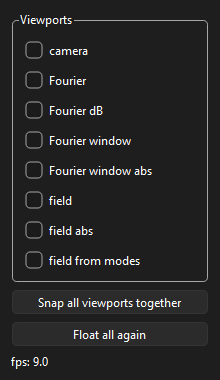

# DigitalHolography

[digHolo](https://github.com/joelacarpenter/digHolo) is Joel Carpenter’s library for off-axis digital holography (Copyright 2021). The DLL, the C++ sources, and `digHolo.h` in this tree come from that repository. His copyright and permission notice stay in `digHolo.h`.

The Python wrapper around that DLL, including the ctypes header and the C++/DLL calling layer, was written by Daniel Dahl. This repository starts from that wrapper.

`pyDigHolo` is ModeLab’s engine package around that DLL: configure hologram processing with `setProps`, run batches offline or from a camera stream, inspect results, and optionally open a live viewport UI.

## Install

Python 3.11 or newer.

```bash
pip install "pyDigHolo @ git+https://github.com/MarKo7s/DigitalHolography.git@v0.2.0"
```

Engine only. For the live viewport UI:

```bash
pip install "pyDigHolo[gui] @ git+https://github.com/MarKo7s/DigitalHolography.git@v0.2.0"
```

That install includes `digHolo.dll` from `pyDigHolo/digHolo_v1.0.0/bin/Win64`.

Editable checkout:

```bash
pip install -e .
pip install -e ".[gui]"
```

```bash
conda env create -f environment.yml
```

On Windows, install PySide6 (and other Qt deps) via pip — do not mix conda Qt with pip PySide6.

## Layout

| Piece | Role |
|-------|------|
| `DigHolo` | DLL handle, `setProps` / `processBatch`, process lock, results |
| `Properties` | Settings dictionary applied to / read from the DLL |
| `digholoResults` | Fields, coefficients, Fourier planes, viewports |
| `DigHoloFeeder` | Background thread: camera frames → `processBatch` |
| `pyDigHolo.ui.DigHoloViewport` | Live multi-mode viewport windows |
| `config/appSettings.json` | Logger paths and flags |

## What digHolo does (brief)

Off-axis digital holography recovers the complex optical field from a camera interferogram (signal + tilted reference). digHolo:

1. Takes a window around each polarisation’s beam centre on the camera (`fftWindowSize*`, `BeamCentre*`).
2. FFTs into the Fourier plane and keeps an off-axis aperture (`FFTRadius`).
3. IFFTs to a reconstructed field (`resolutionMode`).
4. Projects that field onto a modal basis (`basisType`, `maxMG`) and returns complex coefficients.

`setProps(...)` writes those knobs into the DLL. Defaults live in `Properties.defaults()`.

### `setProps` fields

**Source / batch**

| Key | Meaning |
|-----|---------|
| `PixelSize` | Camera pixel pitch (m). |
| `Wavelength` | Centre wavelength (m). |
| `WavelengthCount` | Number of wavelengths (set when applying a wavelength axis). |
| `FrameWidth` / `FrameHeight` | Frame size in pixels (often updated from the buffer you process). |
| `polCount` | Polarisations (1 or 2). |
| `batchCount` | Independent frames in one batch (e.g. spatial channels). |
| `AvgCount` | Frames averaged per batch element before decomposition. |

**Fourier window**

| Key | Meaning |
|-----|---------|
| `fftWindowSizeX` / `fftWindowSizeY` | Camera-plane FFT window size (pixels). |
| `FFTRadius` | Fourier-plane aperture radius (fraction of the plane). |
| `BeamCentreXPolH/V`, `BeamCentreYPolH/V` | FFT window centre per polarisation (pixels). |
| `XTilt*`, `YTilt*` | Reference tilt / off-axis carrier (degrees-related DLL units). |
| `DefocusPolH/V` | Defocus term per polarisation. |
| `resolutionMode` | Reconstructed-field sampling (full vs Fourier-window native). |

**Modal basis**

| Key | Meaning |
|-----|---------|
| `basisType` | `0` HG, `1` LG, `2` custom. |
| `maxMG` | Highest mode group / basis extent. |
| `BasisWaistPolH/V` | Basis waist scale per polarisation. |
| `goalIdx` | Auto-align metric (`IL`, `MDL`, … — see `digholoMetrics`). |

**Auto-align flags** (`1` = enabled)

`AutoAlignBeamCentre`, `AutoAlignDefocus`, `AutoAlignTilt`, `AutoAlignBasisWaist`, `AutoAlignFourierWindowRadius`.

**Misc:** `verbosity` — DLL console detail.

```python
from pyDigHolo import DigHolo

dh = DigHolo()
dh.setProps(
    PixelSize=6.9e-6,
    Wavelength=843.5e-9,
    polCount=2,
    maxMG=22,
    fftWindowSizeX=128,
    fftWindowSizeY=128,
    FFTRadius=0.5,
    basisType=0,
    resolutionMode=0,
)
dh.getProps()   # sync dict from DLL where getters exist
```

## Frame layout (important)

digHolo expects each frame as **height × width** with:

- **Dual polarisation side-by-side (horizontal):** H and V share one image with pols next to each other along **width**, not stacked vertically. Set `polCount=2` accordingly.
- **Dimensions multiples of 16:** FFT constraints require `FrameHeight` and `FrameWidth` divisible by 16. `processBatch` and `DigHoloFeeder` **automatically crop** the top-left region down to the next multiple of 16 and sync those props — same rule as the lab notebooks (`H -= H % 16`, `W -= W % 16`).

Pass float32 arrays shaped `(batch, height, width)` (or 2D for one frame).

## Typical use: offline engine

```python
import numpy as np
from pyDigHolo import DigHolo

dh = DigHolo()
dh.setProps(PixelSize=20e-6, Wavelength=1310e-9, polCount=2, maxMG=22,
            fftWindowSizeX=128, fftWindowSizeY=128)

# frames: float32, (N, H, W); H/W need not already be % 16 — processBatch crops
coefs = dh.processBatch(frames[None, 0, ...], batchCount=1)
fields = dh.getFields()          # complex (batch, pol, w, h)
img, meta = dh.getViewPort(1)    # RGB bitmap + [unit, value, dims]

# Optional: copy so digHolo does not alias your array after return
coefs = dh.processBatch(frames, batchCount=1, makeBufferCopy=True)
```

Viewport modes: `1` camera, `2`–`5` Fourier variants, `6`–`8` reconstructed field variants (`VIEWPORT_MODES` in `pyDigHolo.ui`).

## Streaming from a camera

`DigHoloFeeder` is **camera-agnostic**. It only needs:

1. Any object that exposes a **grab method** returning the last *N* frames from a buffer — either an `ndarray` `(N, H, W)` / `(H, W)`, or `(ndarray, …)` (e.g. frames + ids).
2. That method’s **name** as a string (`cam_grab_ufunc_name`).
3. Enough buffered frames for your `averaging` (if the buffer is smaller than *N*, you get fewer frames and a warning).

You can use ModeLab’s [`cameras`](https://github.com/MarKo7s/cameras) package (example below), or any other driver with a compatible buffer API.

```python
from pyDigHolo import DigHolo, DigHoloFeeder

# --- example with ModeLab cameras (optional) ---
# pip install "cameras[gui] @ git+https://github.com/MarKo7s/cameras.git@v…"
from cameras.alliedvision import VimbaXInterface, VimbaXCamera

iface = VimbaXInterface()
raw = iface._cameras_found[0]
# ring depth must allow averaging: get_tail(n) returns at most ring_buffer_size - 1
cam = VimbaXCamera(raw, ring_buffer_size=32, camera_buffer_size=16)
cam.start_streaming()
grab_name = "get_tail"
# --- end example; substitute your own cam + grab_name ---

frame, _ = cam.get_tail(1)          # or your grab(1)
# shape (1, H, W) or (H, W); dual-pol: H|V along width
_, frame_H, frame_W = frame.shape if frame.ndim == 3 else (1, *frame.shape)

dh = DigHolo()
dh.setProps(
    PixelSize=6.9e-6,
    Wavelength=843.5e-9,
    polCount=2,
    FrameWidth=frame_W,             # feeder snaps these to % 16 if needed
    FrameHeight=frame_H,
    fftWindowSizeX=128,
    fftWindowSizeY=128,
    FFTRadius=0.5,
)

streamer = DigHoloFeeder(
    dh_Object=dh,
    cam_Object=cam,                 # any object with the grab method
    cam_grab_ufunc_name=grab_name,  # called as getattr(cam, name)(averaging)
    averaging=1,
    startStream=True,
    refresh_rate_fps=30,
)

streamer.get_processing_stats()   # (processing_fps, loop_fps)
streamer.set_averaging(8)         # needs buffer depth > 8
# streamer.pause() / resume() / kill()
```

While the feeder runs you can still call `dh.setProps(...)` for alignment (centres, tilts, waist, FFT radius). Batch processing and camera-plane viewport reads share `_process_grab_lock` so the UI and feeder do not race inside the DLL.

## Live viewport widget

With `[gui]` installed and a `DigHolo` already processing (offline loop or feeder):

```python
%gui qt   # in Jupyter

from pyDigHolo.ui import DigHoloViewport

vp = DigHoloViewport(dh, refresh_rate_fps=20)
vp.show()
vp.start()
```

- **Modes** panel: checkboxes open floating plots (camera, Fourier, field, …), tiled from the top-left.
- **Snap all / Float all**: group into one window or separate again.
- Closing a plot (or the snap host) clears the matching checkbox(es).
- Window size follows array aspect ratio and `VIEWPORT_DEFAULT_SIZE` in `digholoViewportViews.py`.
- Logs: `%PROGRAMDATA%\LAB\algorithms\DigitalHolography\Viewport\DigHoloViewport.log` (`appSettings.json`; `reset_logger` truncates each new `DigHoloViewport`).

<!-- gui-screenshot -->

<!-- /gui-screenshot -->

Further widgets can attach the same way: hold a `DigHolo` reference, poll under the process lock where needed, and call `setProps` / result getters for live controls.

## Threading and buffers

digHolo points at your float32 frame memory via `digHoloSetBatch`; viewport RGB/title buffers are also shared inside the DLL. Concurrent `processBatch` and `getViewPort` without the wrapper lock can crash or corrupt titles.

- Lock covers `SetBatch` / `ProcessBatch` (and frequency-sweep batch).
- Camera-plane `getViewPort(1)` takes the same lock.
- Use `makeBufferCopy=True` when the source array may change before the DLL is done.

## Versioning

`pyproject.toml` is the only version source. `pyDigHolo.__version__` reads the installed package metadata.

## Releasing

1. Add a `## [X.Y.Z]` section at the top of `CHANGELOG.md`.
2. Set `version` in `pyproject.toml` to the same number.
3. Commit.
4. From the release branch: `python scripts/release.py --from-changelog --branch <branch>`.
